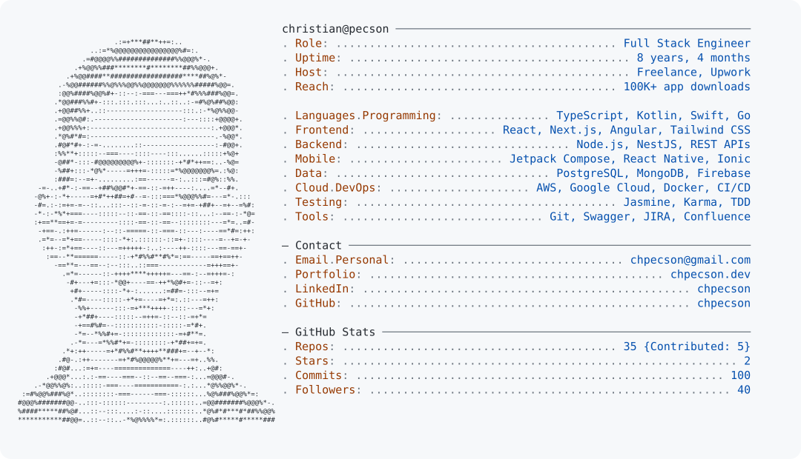

<a href="https://chpecson.dev">
  <picture>
    <source media="(prefers-color-scheme: dark)" srcset="./dark_mode.svg">
    
  </picture>
</a>

[Portfolio](https://chpecson.dev) · [Email](mailto:chpecson@gmail.com) · [LinkedIn](https://www.linkedin.com/in/chpecson/) · [Blog](https://chpecson.dev/blog)

Skills in plain text

- **Frontend:** Next.js, React, Angular, TypeScript, HTML5, CSS3 / Sass, Tailwind CSS, PostCSS, ESLint, Figma-to-Code.
- **Backend & APIs:** Node.js, NestJS, RESTful API Design, JWT Authentication, Role-Based Access Control.
- **Mobile Development:** Kotlin, Jetpack Compose, Android SDK, Room, MVVM, Hilt, React Native, Ionic, Google Maps API, App Store & Play Store Deployment.
- **Databases & Data:** MongoDB, PostgreSQL, Firebase, SQL, JSON, YAML.
- **DevOps & Cloud:** Docker, CI/CD, AWS, Google Cloud Platform, Firebase, DigitalOcean, Serverless Architectures.
- **Testing & Quality:** Jasmine, Karma, Unit & Integration Testing, Test-Driven Development, Debugging & Performance Optimization.
- **Tools & Practices:** Git, Swagger, Agile / Scrum, UML, Design Patterns, JIRA, Confluence.

Terminal-style layout inspired by [Andrew Grant](https://github.com/Andrew6rant/Andrew6rant). Skills from [my portfolio](https://chpecson.dev/stack).
